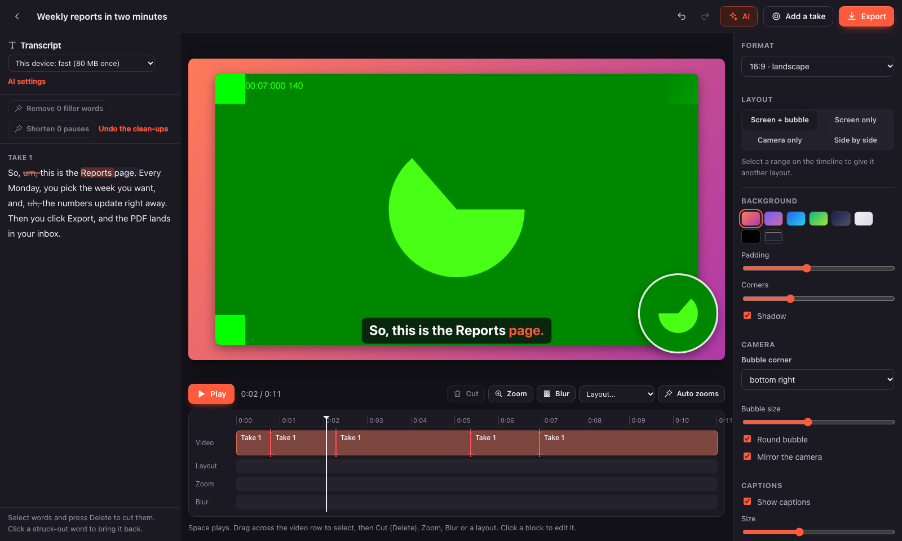
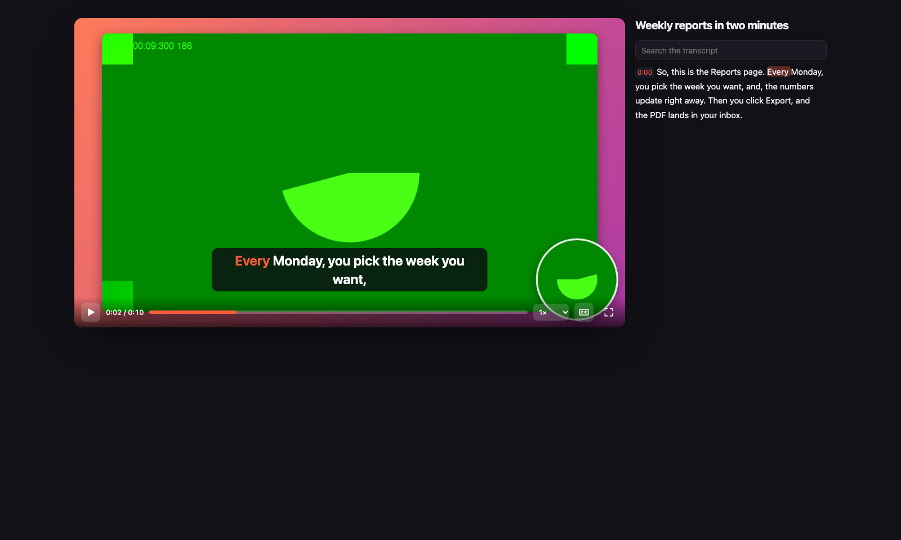

# takeone

Record your screen, camera and voice, edit the video by editing its text, and share it without a
server. takeone is a web page: no account, no upload, no subscription, no watermark. Everything,
from recording to the 4K export, happens in your browser.

**→ [maxgfr.github.io/takeone](https://maxgfr.github.io/takeone/)**



## What it does

1. **Record.** The screen (with the tab's or system's sound), a camera and a microphone, each
   into its own file on this device (Origin Private File System), on one clock. A countdown,
   pause, and floating controls with a teleprompter in a Picture-in-Picture window that a shared
   tab does not show. While you record, where the screen changes is noted for zooms. Add as many
   takes as you want.
2. **Edit by text.** Each take is transcribed, timed to the word, by your AI provider
   (OpenAI, Gemini, Mistral, Groq) or by Whisper running on this device (WebGPU or WebAssembly,
   downloaded once). Select words and press Delete to cut them; click a struck-out word to bring it
   back. Filler words (in 14 languages) and long pauses go in one click each.
3. **Make it look finished.** Layouts per part (screen with a camera bubble, screen only, camera
   only, side by side) that slide from one to the next; zooms placed where you clicked, editable;
   blurred regions over time; backgrounds, padding, rounded corners, shadows; 16:9, 9:16, 1:1 or
   4:3; captions with the word being said lit up, in other languages too.
4. **Let AI edit, if you want.** With your own key, one button: the model reads what you said
   and looks at stills of your screen, then places zooms on what you talk about, switches to the
   camera or the screen alone where it fits, blurs personal data it sees (emails, keys, phone
   numbers), cuts retakes, filler words and long pauses, and adds chapters, all in one undo step
   with each change listed to drop. It also writes the title, summary and description, posts for
   LinkedIn and X, and translates the captions.
5. **Share.** Export MP4 (H.264, up to 4K at 60 fps), WebM, GIF, the sound alone, the transcript,
   SRT/VTT captions, or one HTML file that plays offline with chapters, captions and a searchable
   transcript. Or send a **live link**: the video streams from your tab, peer to peer, and you see
   who is watching, how far they got and their reactions.

The sound is cleaned up on export: noise removed with RNNoise, the voice levelled to −16 LUFS
(EBU R128), the screen's own sound mixed in at the volume you set.

|               |                                                                                                                                                                                                  |
| ------------- | ------------------------------------------------------------------------------------------------------------------------------------------------------------------------------------------------ |
| Recording     | `getDisplayMedia` + `getUserMedia`, one `MediaRecorder` per source writing chunk by chunk to OPFS, remuxed afterwards by [mediabunny](https://mediabunny.dev) so the editor seeks fast.          |
| Editing       | Cuts, layouts, zooms and blurs are ranges on each take's own clock: the output timeline is derived, so cutting a sentence moves everything after it and undo always works.                       |
| Compositor    | One canvas function draws any instant of the edit, for the preview and every export, at any size and shape.                                                                                      |
| Transcription | [llm-connect](https://github.com/maxgfr/llm-models/tree/main/packages/llm-connect): your provider's speech-to-text model, or Whisper on the device through transformers.js in a worker.          |
| Exports       | WebCodecs through mediabunny (H.264/HEVC + AAC/Opus, VP9/AV1 + Opus), gifenc for GIFs.                                                                                                           |
| Live links    | WebRTC data channels; peers find each other through public Nostr relays and WebTorrent trackers, every signaling message sealed with a key that only lives in the link's fragment.               |
| AI            | Bring your own key (or a local OpenAI-compatible server such as Ollama); calls go straight from the browser to the provider. The key is encrypted at rest under a non-extractable WebCrypto key. |
| Storage       | Projects in IndexedDB, media in OPFS. Nothing leaves the device unless you export it, share it, or send audio and text to the AI provider you chose.                                             |

Shortcuts in the editor: `Space` play/pause, `←` `→` one second (`⇧` five), drag across the
video row to select, `Delete` cuts the selection or the selected words, `⌘Z` / `⇧⌘Z` undo and redo,
`Esc` deselects. In the player: `Space`/`K`, `J`/`L` ten seconds, `←` `→` five, `F` full screen,
`C` captions.



## Privacy

- The page's Content-Security-Policy allows no inline script, no eval and no third-party script.
  It connects only to `https:` APIs (your AI provider, the model catalog, Hugging Face for Whisper's
  weights) and `wss:` relays and trackers for live links.
- Recordings stay in your browser's storage. A live link sends the exported file to the people
  who open it, directly from your tab; relays and trackers only see sealed signaling messages.
- Whisper on the device sends nothing anywhere once its weights are downloaded.

## For AI agents

A project is one JSON document described by a [JSON Schema](https://maxgfr.github.io/takeone/schema.json)
and [llms.txt](https://maxgfr.github.io/takeone/llms.txt): clips (takes) with their files and
transcripts, and the edit as ranges on each take's clock.

## Develop

```bash
bun install
bun run dev        # http://localhost:5173/takeone/, rebuilt on change
bun run test       # unit tests
bun run test:e2e   # Playwright: fake screen, camera and mic; mocked AI; local relay and tracker
bun run lint && bun run typecheck
bun run build      # dist/, deployed to GitHub Pages by .github/workflows/pages.yml
bun run catalog    # refresh public/models.json, the offline fallback of the model catalog
```

Stack: Bun, TypeScript, Preact with signals, Zod, mediabunny, llm-connect and the AI SDK,
transformers.js, RNNoise (WebAssembly), gifenc, @noble for the signaling crypto. MIT license.
